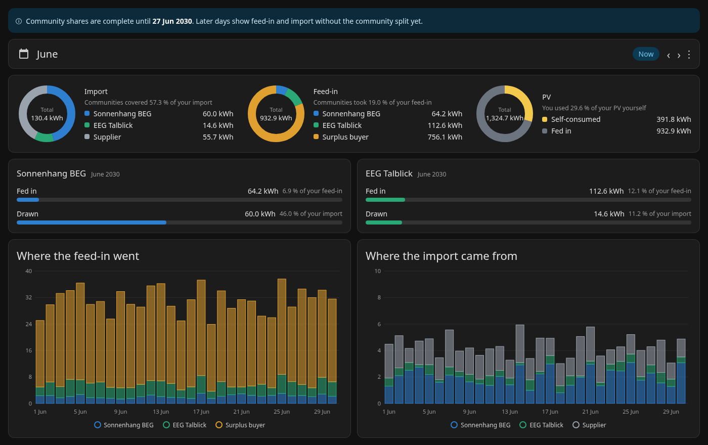

<p align="center">
  
</p>

<h1 align="center">EG Austria für Home Assistant (inoffiziell)</h1>

<p align="center">
  Stündliche kWh der Energiegemeinschaft aus dem EG-Austria-Mitgliederportal als Home-Assistant-Statistiken. Nur lesend.
</p>

<p align="center">
  <a href="https://github.com/magicdude4eva/ha-eg-austria/releases"></a>
  <a href="LICENSE"></a>
  <a href="hacs.json"></a>
</p>

<p align="center">
  <a href="README.md">English</a> · <b>Deutsch</b>
</p>

**[EG Austria](https://eg-austria.at/) organisiert Energiegemeinschaften in
Österreich (Bürgerenergiegemeinschaften, BEG, und Erneuerbare-Energie-
Gemeinschaften, EEG) und bietet jedem Mitglied ein Webportal mit den
gemessenen Stundenwerten seiner Zählpunkte. Diese Integration liest diese
Werte und importiert sie in die Langzeitstatistiken von Home Assistant:
Bezug, Einspeisung und wie viel davon mit deinen Gemeinschaften geteilt
wurde, pro Stunde. Sie liest nur, ist von der Community gebaut und
inoffiziell.**

> **Nicht mit EG Austria verbunden, nicht von EG Austria unterstützt.** Die
> Integration nutzt die undokumentierte Web-API des Portals, die sich jederzeit
> ändern kann. Sie liest nur deine Energiedaten und ändert nichts in deinem
> Portalkonto. Einzige Ausnahme: das Erstellen oder Widerrufen ihres eigenen
> Zugangstokens (nur zum Lesen), und das nur im Einrichtungsassistenten und
> nur, wenn du zustimmst.

> [!TIP]
> **Neu bei EG Austria?** Wenn dir diese Integration nützt, kannst du dich mit
> meinem Empfehlungslink anmelden: <https://eg-austria.at/?ref=L79Y5W9G> (Code
> `L79Y5W9G`). Das unterstützt den Maintainer und kostet dich nichts extra. Es
> ist eine persönliche Empfehlung, kein Sponsoring durch EG Austria.

Die englische [README](README.md) ist die maßgebliche Fassung; die Texte in
Home Assistant erscheinen in der Sprache deiner Installation.

## Inhalt

- [Highlights](#highlights)
- [Bekannte Einschränkungen](#bekannte-einschränkungen)
- [Voraussetzungen](#voraussetzungen)
- [Installation](#installation)
- [Einrichtung](#einrichtung)
- [Token](#token)
- [Damit die Daten fließen](#damit-die-daten-fließen)
- [Was du bekommst](#was-du-bekommst)
- [Optionen](#optionen)
- [Energiegemeinschafts-Dashboard](#energiegemeinschafts-dashboard)
- [Aktionen](#aktionen)
- [Beispiele](#beispiele)
- [Datenaktualisierung](#datenaktualisierung)
- [Reparaturen und Diagnose](#reparaturen-und-diagnose)
- [Fehlerbehebung](#fehlerbehebung)
- [Entfernen](#entfernen)
- [Unterstützte Geräte](#unterstützte-geräte)
- [Datenschutz](#datenschutz)
- [Entwicklung](#entwicklung)

## Highlights

- **Stündliche Statistiken pro Standort und pro Energiegemeinschaft:** Bezug,
  Einspeisung, aus der und an die Gemeinschaft, und der Rest vom Lieferanten
  bzw. an den Überschussabnehmer.
- **Korrekturen werden überschrieben:** jeder Lauf lädt die letzten Wochen
  neu, ein monatlicher Lauf die letzten 13 Monate, damit späte Korrekturen des
  Netzbetreibers in der richtigen Stunde landen.
- **Unbekannt ist nie null:** eine Stunde, die das Portal noch nicht
  vollständig hat, bleibt leer, statt als 0 kWh geschrieben zu werden.
- **Prüfung vor dem Schreiben:** ein geändertes Portalformat schreibt nichts;
  unplausible Werte (zum Beispiel negativ oder zehnfach) werden zurückgehalten,
  alles andere wird geschrieben.
- **Reparaturen** für einen ablaufenden Token, ein geändertes Portal,
  zurückgehaltene Daten und ein nicht erreichbares Portal; eine angekündigte
  Wartung verschiebt den Lauf nur.
- **Geschwärzte Diagnose:** Tokens, IDs, Namen und Werte werden entfernt.
- **Ein Token pro Jahr:** der Assistent kann dein monatliches Sitzungs-Cookie
  in einen Zugangstoken (nur zum Lesen) umwandeln, der ein Jahr gilt.

## Bekannte Einschränkungen

Grundsätzlich, keine Einstellung ändert sie:

- **Undokumentierte API.** Das Portal hat keine öffentliche API. EG Austria
  hat nichts gegen die Integration, verspricht aber keine stabile API. Ein
  Portal-Update kann sie also stören, bis die Integration angepasst ist. In der
  Zwischenzeit wird nichts Falsches geschrieben (siehe
  [Portal geändert](#portal-geändert)).
- **Die Daten kommen spät.** Messwerte eines Tages erscheinen ein bis mehrere
  Tage später, die Gemeinschaftsanteile bis zu Wochen später. Das liegt an den
  Netzbetreibern, nicht an der Integration. Es sind keine Live-Daten.
- **Statistiken, keine Sensoren.** Die Werte sind externe Statistiken. Du
  kannst sie im Energie-Dashboard und in Statistikkarten verwenden, aber sie
  sind keine Entitätszustände, also nicht in Automationen oder
  Verlaufsdiagrammen nutzbar.
- **Nichts vor deinem Aktivierungsdatum.** Das Portal hat für Tage vor dem
  Beitritt deiner Zählpunkte keine Gemeinschaftsdaten, also auch Home
  Assistant nicht.
- **Tokens laufen ab.** Ein Sitzungs-Cookie gilt etwa einen Monat, ein
  Zugangstoken ein Jahr. Vorher kommt eine Reparaturwarnung; dann fügst du ein
  neues Sitzungs-Cookie ein.

Noch nicht umgesetzt (Phasen, siehe [ADR 0010](docs/adr/0010-phasing.md)):

- **Nur kWh.** Geld (Tarife, Vergütung) ist für Phase 2 geplant.
- **Ein Standort pro Eintrag, Summen pro Standort.** Statistiken pro Zählpunkt,
  mehrere Standorte, Zero an andere Standorte und neue Gemeinschaftsmodelle
  sind für Phase 3 geplant, mit Testern aus der Community. Bis dahin: ein
  Eintrag pro Standort.
- Zuerst gegen ein Setup getestet (ein Standort mit Einspeisung und Bezug, eine
  BEG, eine regionale EEG). Andere Setups werden unterstützt, soweit Leute mit
  diesen Setups helfen: bitte
  [ein Issue eröffnen](https://github.com/magicdude4eva/ha-eg-austria/issues).

## Voraussetzungen

- Home Assistant mindestens in der Version des Badges oben (es wird aus
  [`hacs.json`](hacs.json) gelesen, die der Marketplace durchsetzt).
- Ein Mitgliedskonto bei EG Austria mit mindestens einem Zählpunkt in einer
  Energiegemeinschaft.
- Ein Desktop-Browser, um einmal das Sitzungs-Cookie zu kopieren (siehe
  [Token](#token)).

## Installation

**Stand:** veröffentlicht (0.1.0). Die Aufnahme in den Home Assistant
Marketplace (früher HACS) ist beantragt
([#38](https://github.com/magicdude4eva/ha-eg-austria/issues/38)); bis sie
gelistet ist, installierst du sie per Link als benutzerdefiniertes Repository:

1. Öffne den **Marketplace** in Home Assistant.
2. Drei-Punkte-Menü → **Benutzerdefinierte Repositories**,
   `https://github.com/magicdude4eva/ha-eg-austria` mit dem Typ
   **Integration** eintragen und **Hinzufügen** wählen.
3. Suche nach **EG Austria**, öffne den Eintrag und wähle **Herunterladen**.
4. Starte Home Assistant neu.
5. Gehe zu **Einstellungen → Geräte & Dienste → Integration hinzufügen → EG
   Austria**.

> [!NOTE]
> **Sobald die Integration gelistet ist**, entfällt Schritt 2: such im
> Marketplace direkt nach **EG Austria**. Ein bereits hinzugefügtes
> benutzerdefiniertes Repository funktioniert weiter.

Was sich in jedem Release geändert hat, steht im
[Changelog](CHANGELOG.md) (englisch).

Nach dem Hinzufügen öffnet Home Assistant den Dialog **Benennen und
zuweisen** für das Dienstgerät "EG Austria". Ein Bereich ergibt für diesen
Dienst keinen Sinn: einfach **Überspringen und beenden** wählen. Home
Assistant zeigt diesen Dialog für jedes neue Gerät; die Integration kann ihn
nicht abschalten.

## Einrichtung

Der Assistent fragt zuerst nach einem Sitzungs-Cookie aus dem Portal und
bietet dann zwei Wege an:

| Weg | Was gespeichert wird | Gültig | Wähle ihn, wenn |
|---|---|---|---|
| **Zugangstoken erstellen (empfohlen)** | Ein Zugangstoken nur zum Lesen mit dem Namen "Home Assistant" | Ein Jahr | Fast immer. Du fügst einmal im Jahr ein Cookie ein statt jeden Monat. |
| **Sitzungs-Cookie behalten** | Das Sitzungs-Cookie selbst | Etwa einen Monat | Du keinen zusätzlichen Token im Konto willst, oder das Erstellen fehlgeschlagen ist. |

Hast du schon einen persönlichen Token (`ecapi_…`), kannst du ihn statt des
Cookies einfügen; dann fragt der Assistent nach seinem Ablaufdatum und
überspringt die Wahl.

Die Schritte der Reihe nach (Schritte mit nur einer Möglichkeit entfallen):

1. **EG Austria verbinden**, Feld *Sitzungs-Cookie oder Token*: das
   Sitzungs-Cookie einfügen (siehe
   [Das Sitzungs-Cookie: wo du es findest](#das-sitzungs-cookie-wo-du-es-findest)).
   Anführungszeichen und `portal.jwtToken=` werden automatisch entfernt.
2. **Ablauf des persönlichen Tokens**, Feld *Token gültig bis* (nur bei einem
   eingefügten `ecapi_…`-Token): das Ablaufdatum, das du beim Erstellen
   gewählt hast. Standard: ein Jahr ab heute. 30 Tage vorher kommt eine
   Reparaturwarnung.
3. **Mitglied**, Feld *Mitglied* (nur wenn deine Anmeldung für mehrere
   Mitglieder handeln kann): das Mitglied, dessen Energiedaten importiert
   werden.
4. **Nutzungsbedingungen** (nur wenn das Portal meldet, dass du sie noch nicht
   akzeptiert hast): im Browser im Portal anmelden und akzeptieren, sonst
   können die Datenabfragen fehlschlagen.
5. **Standort**, Feld *Standort* (nur wenn das Mitglied mehrere Standorte hat):
   der Standort, dessen Zählpunkte dieser Eintrag importiert. Für einen
   weiteren Standort einen weiteren Eintrag anlegen.
6. **Zugangstoken erstellen?**: *Zugangstoken erstellen (empfohlen)* oder
   *Sitzungs-Cookie behalten* (siehe Tabelle oben). Schlägt das Erstellen
   fehl, sagt der Schritt **Zugangstoken nicht erstellt** warum, und die
   Einrichtung geht mit dem Cookie weiter.
7. **Sitzungstoken läuft bald ab** (nur mit behaltenem Cookie und weniger als
   7 Tagen Restlaufzeit): ein Hinweis; die Einrichtung geht weiter.
8. **Zählpunkte**, Felder *Zählpunkte* und *Standort-Kürzel* (siehe
   [Mitglied, Standort und Zählpunkte](#mitglied-standort-und-zählpunkte) und
   [Kürzel für Standort und Gemeinschaften](#kürzel-für-standort-und-gemeinschaften)).
9. **Energiegemeinschaften**, Felder *Importieren* (die zu importierenden
   Gemeinschaften, standardmäßig alle) und *Kürzel ändern* (standardmäßig aus).
10. **Kürzel der Gemeinschaften**, Felder *Kürzel 1* … *Kürzel 9* (nur mit
    *Kürzel ändern*): ein Kürzel pro gewählter Gemeinschaft.

Der Eintrag heißt "EG Austria Home"; du kannst ihn umbenennen. Der erste
Import startet ein paar Minuten später im Hintergrund (siehe
[Damit die Daten fließen](#damit-die-daten-fließen)).

### Das Sitzungs-Cookie: wo du es findest

1. Im Desktop-Browser im Mitgliederportal <https://portal.eg-austria.at>
   anmelden (das Portal schickt dir einen Anmeldelink per E-Mail).
2. Entwicklertools öffnen (F12) → **Application** (Firefox: **Storage**) →
   **Cookies** → `portal.eg-austria.at`.
3. Den Wert von `portal.jwtToken` kopieren und im Assistenten einfügen.

Das Cookie gibt vollen Zugriff auf dein Portalkonto, solange es gilt. **Gib es
nie weiter**, nicht in einem Issue, einem Forumsbeitrag oder einem Screenshot.
Lässt du den Assistenten einen Zugangstoken erstellen, wird das Cookie für
diese eine Anfrage verwendet und danach verworfen; es wird nicht gespeichert.

### Ablauf des Tokens: was dann passiert

Die Reparatur [Token läuft ab](#token-läuft-ab) erscheint 30 Tage vor dem
Ablauf eines Zugangstokens oder 7 Tage vor dem Ablauf eines Sitzungs-Cookies.
Füge mit **Neu konfigurieren** ein frisches Sitzungs-Cookie ein und lass den
Assistenten einen neuen Token erstellen.

Lehnt das Portal den Token früher ab (abgelaufen, widerrufen oder eine
Portaländerung), zeigt Home Assistant bei der Integration **EG Austria neu
verbinden** (neu authentifizieren). Füge ein frisches Sitzungs-Cookie oder
einen `ecapi_…`-Token desselben Mitglieds ein. Ein Token eines anderen
Mitglieds wird abgelehnt (`wrong_account`).

### Mitglied, Standort und Zählpunkte

Die Listen zeigen, was das Portal liefert: Anzeigenamen der Mitglieder, Straße
und Hausnummer jedes Standorts, und für jeden Zählpunkt die Richtung (Bezug
oder Einspeisung), die **volle** Zählpunktnummer, den Anlagennamen und die
Erzeugungsart sowie den Anteil pro Gemeinschaft. Das erscheint nur im
Assistenten, in deinem eigenen Home Assistant. Gespeichert werden nur interne
IDs; Logs, Diagnose und der Titel des Eintrags enthalten diese Angaben nie.

Standardmäßig sind alle aktiven Zählpunkte gewählt. Mindestens einer ist nötig.

### Kürzel für Standort und Gemeinschaften

Die Kürzel werden Teil der Statistik-IDs, zum Beispiel
`eg_austria:home_consumption` für das Standort-Kürzel `home` und
`eg_austria:home_beg_consumption_from_community` für das Gemeinschaftskürzel
`beg`. **Sie können später nicht geändert werden**: ein anderes Kürzel würde
neue, leere Statistiken beginnen.

- **Standort-Kürzel:** Standard `home`. 1-20 Kleinbuchstaben, Ziffern oder
  `_`, beginnend mit einem Buchstaben. Ein zweiter Eintrag braucht ein anderes
  (`slug_in_use`).
- **Gemeinschaftskürzel:** Standard nach Gemeinschaftstyp: `beg` für eine
  Bürgerenergiegemeinschaft, `eeg` für eine Erneuerbare-Energie-Gemeinschaft,
  dann `eeg2`, …; `ec` für andere Typen. Jede Option unter *Importieren* zeigt
  den Namen der Gemeinschaft, ihren Typ, dein Mitglied-seit-Datum und das
  vorgeschlagene Kürzel nach dem Pfeil. Gleiches Muster wie beim
  Standort-Kürzel, eindeutig im Eintrag (`duplicate_slug`).

Die Anzeigenamen hängen nicht von den Kürzeln ab: Standortstatistiken heißen
"Zuhause …", Gemeinschaftsstatistiken tragen den Namen der Gemeinschaft aus
dem Portal, der bei einer Umbenennung im Portal nachgezogen wird.

### Neu konfigurieren

**Einstellungen → Geräte & Dienste → EG Austria → ⋮ → Neu konfigurieren**.
Hält der Eintrag einen Zugangstoken, den der Assistent erstellt hat, wählst du
zwischen:

- **Token, Zählpunkte oder Gemeinschaften ändern**: optional ein neues
  Sitzungs-Cookie oder einen Token einfügen (leer behält den gespeicherten),
  dann Zählpunkte ändern und Gemeinschaften hinzufügen. Gemeinschaften, die
  das Portal nicht mehr liefert, werden aufgelistet; um die Historie einer
  Gemeinschaft zu behalten, deren Portal-ID sich geändert hat, gib der neuen
  Gemeinschaft ihr altes Kürzel. Nicht wiederverwendete alte Kürzel werden
  stillgelegt. Liefert das Portal den gespeicherten Standort nicht mehr, fragt
  der Schritt **Standort geändert**, zu welchem Standort der Eintrag jetzt
  gehört; die Statistik-IDs bleiben gleich.
- **Zugangstoken widerrufen**: ein frisches Sitzungs-Cookie einfügen (ein
  Zugangstoken kann sich nicht selbst widerrufen, `session_cookie_required`).
  Der Token wird widerrufen; danach erstellst du einen neuen oder behältst das
  Cookie.

Ein ersetzter Token bleibt gültig, bis er abläuft. Widerrufe ihn also vorher,
wenn du ihn nicht mehr brauchst.

## Token

Zusammenfassung der [Einrichtung](#einrichtung) und des Token-Lebenszyklus:

- **Sitzungs-Cookie** (`portal.jwtToken`): aus dem Browser kopiert, etwa einen
  Monat gültig. Wird bei Einrichtung, Neuauthentifizierung, Neukonfiguration
  und Widerruf eingefügt.
- **Zugangstoken** (`ecapi_…`): vom Assistenten aus dem Cookie erstellt, **nur
  zum Lesen**, Name "Home Assistant", ein Jahr gültig. EG Austria schickt dir
  dazu eine E-Mail ("Neuer Access-Token erstellt"). Diese E-Mail ist erwartet.
- Die Integration speichert nur den verwendeten Token, sein Ablaufdatum und
  (bei einem selbst erstellten Token) dessen ID im Konfigurationseintrag von
  Home Assistant. Sie loggt den Token nie und zeigt ihn nie wieder an.
- **Widerrufen:** Neu konfigurieren → **Zugangstoken widerrufen** (siehe
  [Neu konfigurieren](#neu-konfigurieren)). Das Portal hat noch keine eigene
  Seite, um Tokens aufzulisten oder zu widerrufen. Ist das Erstellen in ein
  Zeitlimit gelaufen, kann der Token trotzdem existieren (du bekommst die
  E-Mail); der Assistent kennt dann seine ID nicht und kann ihn nicht
  widerrufen.

## Damit die Daten fließen

1. **Deine Mitgliedschaft in der Gemeinschaft muss aktiv sein.** Das Portal hat
   Gemeinschaftsdaten erst ab dem Tag, an dem deine Zählpunkte beigetreten
   sind.
2. **Den Assistenten abschließen.** Während der Einrichtung wird nichts
   importiert.
3. **Ein paar Minuten warten.** Der erste Import startet 1-5 Minuten nach der
   Einrichtung im Hintergrund. Mit **Historie ab der ersten Aktivierung
   importieren** (Standard) lädt er alles ab deinem ersten Aktivierungsdatum,
   Monat für Monat, mit Pausen zwischen den Anfragen; ein Jahr Historie dauert
   ein paar Minuten.
4. **Die letzten Tage sind oft leer.** Gestern und die Tage davor fehlen oft
   noch oder sind im Portal selbst unvollständig. Sie füllen sich bei den
   nächsten täglichen Läufen. Gemeinschaftsanteile können Wochen dauern. **Das
   ist normal, kein Fehler.**
5. **Diagnosesensoren prüfen** am Gerät "EG Austria": *Status des letzten
   Laufs* sollte *OK* sein, *Letzter Import* zeigt wann, und *Daten
   vollständig bis* den letzten Tag, für den das Portal vollständige Daten
   hatte.
6. **Statistiken finden** unter **Entwicklerwerkzeuge → Statistiken** (nach
   `eg_austria` suchen), dann ins Energie-Dashboard oder eine Statistikkarte
   übernehmen.

## Was du bekommst

### Statistiken

Externe Statistiken, Einheit kWh, stündlich, mit laufender Summe. `<site>` und
`<c>` sind deine [Kürzel](#kürzel-für-standort-und-gemeinschaften).

| Statistik-ID | Name | Bedeutung |
|---|---|---|
| `eg_austria:<site>_consumption` | Zuhause Bezug | Gemessener Bezug der gewählten Bezugszählpunkte |
| `eg_austria:<site>_generation` | Zuhause Einspeisung | Gemessene Einspeisung der gewählten Einspeisezählpunkte |
| `eg_austria:<site>_consumption_from_community` | Zuhause Bezug aus Gemeinschaften | Bezug, den alle deine Gemeinschaften zusammen gedeckt haben |
| `eg_austria:<site>_generation_to_community` | Zuhause Einspeisung an Gemeinschaften | Einspeisung, die alle deine Gemeinschaften zusammen abgenommen haben |
| `eg_austria:<site>_consumption_from_supplier` | Zuhause Bezug vom Lieferanten | Der Rest, von deinem Stromlieferanten |
| `eg_austria:<site>_generation_to_surplus` | Zuhause Einspeisung an Überschussabnehmer | Der Rest, an deinen Überschussabnehmer |
| `eg_austria:<site>_<c>_consumption_from_community` | *Name der Gemeinschaft* Bezug aus Gemeinschaft | Bezug, den Gemeinschaft `<c>` gedeckt hat |
| `eg_austria:<site>_<c>_generation_to_community` | *Name der Gemeinschaft* Einspeisung an Gemeinschaft | Einspeisung, die Gemeinschaft `<c>` abgenommen hat |

Statistiken einer Richtung ohne gewählten Zählpunkt (zum Beispiel
Einspeisung, wenn du nur einen Bezugszählpunkt gewählt hast) werden nicht
angelegt. Die eigenen Statistiken einer Gemeinschaft beginnen an ihrem
Aktivierungsdatum. Die Namen folgen der Sprache von Home Assistant.

### Diagnosesensoren

Am Dienstgerät "EG Austria":

| Sensor | Zeigt |
|---|---|
| Token läuft ab | Wann der gespeicherte Token abläuft |
| Daten vollständig bis | Letzter Tag der lückenlosen Folge von Tagen, die das Portal als vollständig meldet (Gemeinschaftsanteile) |
| Zählerdaten bis | Letzter Tag mit Zählerwerten für jede Stunde; meist rund zwei Wochen vor *Daten vollständig bis* |
| Letzter Import | Ende des letzten erfolgreichen Laufs |
| Status des letzten Laufs | *OK*, *Teilweise importiert*, *Übersprungen (Wartung)*, *Anmeldung fehlgeschlagen*, *Portal geändert*, *Portal nicht erreichbar*, *Anfragelimit erreicht*; bleibt über Neustarts erhalten |
| Portal-Version | Der Build des Portals (standardmäßig deaktiviert) |

Sie bleiben verfügbar, wenn das Portal ausfällt: *Status des letzten Laufs*
zeigt dann *Portal nicht erreichbar*. Es gibt keine Energiesensoren; die
Energiewerte gibt es nur als Statistiken.

### Zusammenfassungssensoren

Anteile in Prozent, die Statistikkarten nicht berechnen können. Jeder kommt
zweimal: *Monat bisher* (vom 1. dieses Monats bis *Daten vollständig bis*) und
*Vormonat* (der letzte Monat, dessen Tage alle vollständig sind). Zähler und
Nenner decken immer dieselben vollständigen Stunden ab, damit die späten
Gemeinschaftsdaten und deine Live-Quellen zusammenpassen.

| Sensor | Anteil |
|---|---|
| Einspeisung an Gemeinschaften | Einspeisung an Gemeinschaften ÷ gemessene Einspeisung |
| Bezug aus Gemeinschaften | Bezug aus Gemeinschaften ÷ gemessener Bezug |
| *Gemeinschaft* Einspeiseanteil | Anteil dieser Gemeinschaft an der gemessenen Einspeisung |
| *Gemeinschaft* Bezugsanteil | Anteil dieser Gemeinschaft am gemessenen Bezug |
| PV selbst verbraucht | (PV-Erzeugung − gemessene Einspeisung) ÷ PV-Erzeugung, 0-100 % (nur mit [PV-Quelle](#vergleichsquellen)) |
| PV an Gemeinschaften | Einspeisung an Gemeinschaften ÷ PV-Erzeugung (nur mit PV-Quelle) |
| PV an Überschussabnehmer | Einspeisung an den Überschussabnehmer ÷ PV-Erzeugung (nur mit PV-Quelle) |
| Abweichung Einspeisung | (deine Einspeisequelle − gemessene Einspeisung) ÷ gemessene Einspeisung (nur mit Einspeisequelle) |
| Abweichung Netzbezug | (deine Netzbezugsquelle − gemessener Bezug) ÷ gemessener Bezug (nur mit Netzbezugsquelle) |

Attribute: `period_start`, `period_end`, `numerator_kwh`, `denominator_kwh`.
Ein Sensor ist unbekannt, solange sein Zeitraum noch keinen vollständigen Tag
hat (am Monatsanfang ist *Monat bisher* das oft) oder der Nenner 0 ist. Sie
haben keine State-Class, Home Assistant führt also keine Langzeitstatistik
dazu; die kWh-Werte bleiben in den Statistiken oben
([ADR 0014](docs/adr/0014-summary-sensors.md)). Die Werte werden nach dem Start
von Home Assistant und nach jedem Import neu berechnet.

> [!TIP]
> 💡 **Energie-Dashboard:** die Integration ändert dein Energie-Dashboard nie.
> Hast du schon eine Live-Quelle vor Ort (Smart-Meter-Leser, Wechselrichter),
> behalte sie für Netzbezug, Netzeinspeisung und Solar: die Portaldaten kommen
> Tage später, und beide zusammen zählen doppelt. Nutze die
> `eg_austria`-Statistiken in Statistikkarten zum Vergleich und für deine
> Gemeinschaftsanteile.
>
> Ohne Live-Quelle kannst du sie unter **Einstellungen → Dashboards →
> Energie** wählen: **Netzbezug** → `eg_austria:<site>_consumption`,
> **Netzeinspeisung** → `eg_austria:<site>_generation`. Die letzten Tage
> bleiben dann leer, bis das Portal sie hat.

## Optionen

**Einstellungen → Geräte & Dienste → EG Austria → Konfigurieren**, dann
*Import-Einstellungen* oder *Vergleichsquellen* wählen. Jeder Schritt speichert
nur seine eigenen Felder. Der Eintrag wird beim Speichern neu geladen.

### Import-Einstellungen

| Option | Standard | Bereich | Wirkung |
|---|---|---|---|
| Plausibilitätsgrenze pro Stunde (kWh) | 50 | 1-1000, Schritt 0,5 | Stundenwerte darüber werden als unplausibel zurückgehalten. |
| Tägliches Nachladefenster (Tage) | 62 | 31-400 | Die letzten Tage, die bei jedem täglichen Lauf neu geladen werden. |
| Monatliches Nachladefenster (Monate) | 13 | 1-36 | Monate, die der monatliche Lauf neu lädt (späte Korrekturen). |
| Historie ab der ersten Aktivierung importieren | Ein | ein/aus | Beim ersten Lauf alle Daten seit dem Beitritt der Zählpunkte zu einer Gemeinschaft importieren. Aus: nur das tägliche Fenster. |

### Vergleichsquellen

Optionale Energiestatistiken deines eigenen Live-Zählers oder Wechselrichters,
die mit den Portaldaten verglichen werden (Zusammenfassungen und das erzeugte
Dashboard bauen darauf auf). Jede Marke funktioniert; jedes Feld nimmt eine
Energiestatistik mit Summe (State-Class `total` oder `total_increasing`,
Einheit Wh, kWh, MWh, …).

| Option | Wirkung |
|---|---|
| Netzeinspeisung | Ins Netz eingespeiste Energie, wie dein Live-Zähler oder Wechselrichter sie misst. |
| Netzbezug | Aus dem Netz bezogene Energie, wie dein Live-Zähler oder Wechselrichter sie misst. |
| PV-Erzeugung | Gesamte Erzeugung deiner PV-Anlage. Ohne sie entfallen PV-Karten und -Werte. |

Bis du diesen Schritt einmal speicherst, sind die Felder aus dem
Energie-Dashboard vorausgefüllt: *Ins Netz eingespeist* und *Netzbezug* der
ersten Netzquelle und die erste Solarquelle. Die Integration liest diese
Einstellungen nur und ändert sie nie. Lass ein Feld leer, wenn du diese Quelle
nicht hast; die eigenen `eg_austria:`-Statistiken der Integration lassen sich
hier nicht wählen.

## Energiegemeinschafts-Dashboard

Die Integration bringt ein fertiges Dashboard mit: Standardkarten und zwei
kleine eigene Karten, die der Datumsauswahl folgen. Es verwendet die
Statistiken deines Eintrags und die gewählten
[Vergleichsquellen](#vergleichsquellen) und lässt Karten für nicht gesetzte
Quellen weg.

**Einmal hinzufügen:** **Einstellungen → Dashboards → Dashboard hinzufügen**,
dann unter *Benutzerdefiniert* **EG Austria energy community** wählen. Die
Integration legt Dashboards nie selbst an und ändert sie nicht. Das Dashboard
wird bei jedem Laden neu aufgebaut; eine neue Quelle oder Gemeinschaft
erscheint also ohne Bearbeiten. Um es von Hand zu ändern, im Dashboard-Menü
*Kontrolle übernehmen* wählen; danach bleibt es so, wie du es bearbeitet hast.

Der Dialog schlägt den Titel *Energiegemeinschaft* und das Symbol
`mdi:home-group` vor; beides lässt sich ändern.



*Beispiel mit erfundenen Daten.*

Was es zeigt, eine Ansicht pro EG-Austria-Eintrag, von oben nach unten:

| Teil | Karten |
|---|---|
| Gewählter Zeitraum | Ein Hinweis zu den zwei Verzögerungen (Gemeinschaftsanteile vollständig bis *Daten vollständig bis*, Zählerwerte bis *Zählerdaten bis*); der **Importstatus** in einer Zeile: *Daten vollständig bis*, *Zählerdaten bis*, *Letzter Lauf* (grün bei OK, orange, wenn ein späterer Lauf aufholt: teilweise, Wartung, Ratenlimit; rot, wenn du eingreifen musst: Anmeldung fehlgeschlagen, Portal geändert, nicht verfügbar), *Letzter Import*, *Token läuft ab* als Datum (orange in den letzten zwei Wochen, rot nach Ablauf) und ein Link zum Energie-Dashboard; ein Klick auf einen Wert öffnet seine Details. Dann eine Datumsauswahl, die mit dem **aktuellen Monat** öffnet; mit ‹ › zu früheren Monaten blättern oder eine Woche, ein Jahr oder einen beliebigen Zeitraum wählen. Darunter, der Auswahl folgend: die **Zeitraumkarte** mit drei Ringen: *Bezug* (aus jeder Gemeinschaft und vom Lieferanten, mit dem Anteil, den Gemeinschaften gedeckt haben), *Einspeisung* (an jede Gemeinschaft und an den Überschussabnehmer, mit dem Anteil der Gemeinschaften) und, mit PV-Quelle, *PV* (selbst verbraucht vs. eingespeist); dann **eine Karte pro Gemeinschaft** mit den eingespeisten und bezogenen kWh und ihrem Anteil an deiner gesamten Einspeisung und deinem Bezug; dann wohin die Einspeisung ging und woher der Bezug kam, pro Tag |
| Letzte 12 Monate | Dieselben zwei Aufteilungen pro Monat |
| Deine eigenen Quellen | Mit PV-Quelle PV-Erzeugung vs. gemessene Einspeisung vs. Gemeinschaften pro Monat; mit Einspeise- oder Netzbezugsquelle gemessen vs. deine Quelle im gewählten Zeitraum, als Balken nebeneinander (die beiden stimmen eng überein, Linien würden sich verdecken) |

Diagramme stehen auf breiten Bildschirmen paarweise nebeneinander, am Handy
untereinander. Jede Gemeinschaft behält in allen Diagrammen ihre Farbe (die
erste blau, die zweite grün), der Überschussabnehmer ist orange, der
Lieferant grau. Die Beschriftungen folgen der Sprache deines Profils
(Englisch oder Deutsch).

Die Datumsauswahl merkt sich die zuletzt gewählte Voreinstellung im Browser,
wie das Energie-Dashboard. Solange du keine gewählt hast, legt das Dashboard
dort *Dieser Monat* ab (nur im Browser, nie in Home Assistant), weil *Heute*
noch keine Gemeinschaftsdaten hat: Gemeinschaftsanteile kommen etwa zwei
Wochen später. Die neuesten Tage zeigen Einspeisung und Bezug, aber noch keine
Gemeinschaftsaufteilung, bis das Portal sie hat (*Daten vollständig bis*).

Das (i) in der Ecke der Zeitraum- und Gemeinschaftskarten erklärt, wie ihre
Zahlen zustande kommen. Fahre über ein Ringsegment oder seine Legendenzeile
(am Handy antippen), dann zeigt die Mitte Anteil und kWh, darunter steht
derselbe Teil im Vorzeitraum mit der Änderung in % und der beste Tag; ein
Klick oder Tippen hält die Auswahl, bis du erneut klickst. Zeitraum- und Gemeinschaftskarten zählen nur bis *Daten vollständig bis*,
damit alle Zahlen darin dieselben Tage abdecken; im aktuellen Monat steht dort
*bisher, bis* zu diesem Tag. Den gewählten Zeitraum lesen sie über ein
Detail des Frontends, das keine öffentliche Schnittstelle ist; ändert ein
Home-Assistant-Update es, zeigen sie stattdessen den aktuellen Monat. Die
Datumsauswahl selbst zeigt das Jahr nur für Monate außerhalb des aktuellen
Jahres (ein Home-Assistant-Detail ohne Einstellung); die Gemeinschaftskarten
zeigen es immer. In den eingebauten
Diagrammen hängt Home Assistant an jeden Reihennamen *(Änderung)* an: die kWh
in diesem Balken (die Änderung des Zählerstands); das lässt sich nicht
ausblenden.

## Aktionen

### `eg_austria.refetch`: Neu abrufen

Ruft einen Zeitraum erneut aus dem Mitgliederportal ab und schreibt seine
Statistiken neu. Läuft im Hintergrund.

| Feld | Pflicht | Beschreibung |
|---|---|---|
| `config_entry_id` (Eintrag) | ja | Der EG-Austria-Eintrag. |
| `start_date` (Startdatum) | nein | Erster abzurufender Tag. Standard: das tägliche Fenster (62 Tage) vor dem Enddatum. |
| `end_date` (Enddatum) | nein | Letzter abzurufender Tag. Standard: heute. Höchstens 400 Tage nach dem Startdatum. |

```yaml
action: eg_austria.refetch
data:
  config_entry_id: 0123456789abcdef0123456789abcdef
  start_date: "2026-01-01"
  end_date: "2026-03-31"
```

Abgelehnt, wenn das Startdatum nach dem Enddatum liegt, das Enddatum in der
Zukunft liegt, der Zeitraum länger als 400 Tage ist, der Eintrag unbekannt oder
nicht geladen ist, oder für den Eintrag schon ein Import läuft.

### `eg_austria.release_held`: Zurückgehaltene Tage freigeben

Gibt Tage frei, die die Prüfung zurückgehalten hat, damit der nächste Lauf sie
so schreibt, wie das Portal sie liefert. Startet selbst keinen Lauf. Nur
verwenden, wenn du im Portal geprüft hast, dass die Werte stimmen (siehe
[Zurückgehaltene Daten](#zurückgehaltene-daten)).

| Feld | Pflicht | Beschreibung |
|---|---|---|
| `config_entry_id` (Eintrag) | ja | Der EG-Austria-Eintrag. |
| `statistic_key` (Statistik-Schlüssel) | nein | Nur diese Statistik, zum Beispiel `home_generation` (die Statistik-ID ohne `eg_austria:`). Standard: alle. |
| `date` (Datum) | nein | Nur dieser Tag. Standard: alle zurückgehaltenen Tage. |

```yaml
action: eg_austria.release_held
data:
  config_entry_id: 0123456789abcdef0123456789abcdef
  statistic_key: home_generation
  date: "2026-06-15"
```

Wähle den Eintrag im UI-Editor der Aktion, oder kopiere seine ID aus der
Adresszeile der Seite des Eintrags.

## Beispiele

### Statistikkarte: wie viel aus der Gemeinschaft kam

```yaml
type: statistics-graph
title: Gemeinschaftsanteil
period: day
chart_type: bar
stat_types:
  - change
entities:
  - eg_austria:home_consumption
  - eg_austria:home_consumption_from_community
  - eg_austria:home_consumption_from_supplier
```

### Automation: Benachrichtigung, wenn ein Import nicht durchging

Ersetze die Entitäts-ID durch die deines Sensors *Status des letzten Laufs*
(**Einstellungen → Geräte & Dienste → EG Austria → Gerät**) und die
Benachrichtigungsaktion durch deine.

```yaml
alias: EG Austria Import nicht OK
triggers:
  - trigger: state
    entity_id: sensor.eg_austria_home_last_run_status
    not_to:
      - ok
      - skipped_maintenance
      - unavailable
      - unknown
actions:
  - action: notify.notify
    data:
      title: EG Austria
      message: >-
        Letzter Import: {{ states('sensor.eg_austria_home_last_run_status') }}.
        Siehe Einstellungen → System → Reparaturen.
```

*Übersprungen (Wartung)* ist ausgenommen, weil der Lauf nach der Wartung
wiederholt wird; ein ausgefallenes Portal hat nach drei Tagen seine eigene
Reparatur.

### Automation: ein zusätzlicher wöchentlicher Neuabruf

Jeder geplante Lauf lädt schon die letzten 62 Tage und monatlich die letzten 13
Monate, das ist also selten nötig. Korrigiert dein Netzbetreiber oft, kannst du
jede Woche die letzten 120 Tage neu laden (höchstens 400 Tage pro Aufruf):

```yaml
alias: EG Austria wöchentlicher Neuabruf
triggers:
  - trigger: time
    at: "07:30:00"
conditions:
  - condition: time
    weekday: sun
actions:
  - action: eg_austria.refetch
    data:
      config_entry_id: 0123456789abcdef0123456789abcdef
      start_date: "{{ (now() - timedelta(days=120)).date() }}"
```

## Datenaktualisierung

Die Integration fragt das Portal ab (Cloud-Polling); es kann nichts pushen.

- **Täglicher Lauf** zu einer festen Zeit zwischen 03:00 und 06:00 Ortszeit,
  bei der Einrichtung pro Eintrag zufällig gewählt. Er lädt ab 62 Tagen zurück
  (das *Tägliche Nachladefenster*), oder weiter zurück bis zum frühesten
  unvollständigen Tag der letzten 120 Tage, bis heute.
- **Monatlicher Lauf:** der erste tägliche Lauf am oder nach dem 3. jedes
  Monats lädt stattdessen die letzten 13 Monate (*Monatliches
  Nachladefenster*), für späte Korrekturen.
- **Erster Lauf:** nach der Einrichtung alles ab dem ersten Aktivierungsdatum
  (wenn *Historie … importieren* an ist). Die täglichen Läufe wiederholen ihn,
  bis er gelingt.
- **Nach einem Neustart:** ein Nachhol-Lauf 1-5 Minuten nach dem Start von
  Home Assistant, wenn der letzte erfolgreiche Lauf älter als 26 Stunden ist.
  Keiner, wenn in der letzten Stunde ein Lauf versucht wurde.
- **Wartung:** vor jedem Lauf werden die angekündigten Wartungsfenster des
  Portals geprüft. Liegt der Lauf in einem (± 30 Minuten), wird er auf 30
  Minuten nach dessen Ende verschoben (*Übersprungen (Wartung)*).
- **Last:** Anfragen gehen nacheinander, mindestens 2 Sekunden Abstand, etwa
  4-10 pro täglichem Lauf und 15-30 beim monatlichen Lauf. Nach einem
  Anfragelimit lässt sich der nächste Lauf mehr Zeit.
- **Jeder Lauf schreibt sein ganzes Fenster neu**, korrigierte Werte ersetzen
  also die alten. Eine Stunde, die in einem Lauf unbekannt ist, behält ihren
  gespeicherten Wert.
- **Wie spät die Daten kommen:** Messwerte ein bis mehrere Tage,
  Gemeinschaftsanteile bis zu Wochen. Ein Tag gilt als vollständig, sobald das
  Portal ihn so markiert.

## Reparaturen und Diagnose

Die Integration meldet unter **Einstellungen > System > Reparaturen**, wenn
sie dich braucht. Jede Meldung verschwindet von selbst, wenn die Ursache weg
ist. (Die Links in den Meldungen führen zur englischen README.)

### Token läuft ab

Erscheint 30 Tage vor dem Ablauf eines Zugangstokens (oder dem Datum, das du
für einen persönlichen Token eingegeben hast) oder 7 Tage vor dem Ablauf eines
Sitzungstokens. Erstelle einen neuen Token und füge ihn mit **Neu
konfigurieren** auf der Seite der Integration ein (siehe [Token](#token)).
Lehnt das Portal den Token früher ab, fragt Home Assistant stattdessen nach
einer Neuauthentifizierung.

### Portal geändert

Das Portal hat in einem Format geantwortet, das die Integration nicht kennt,
oder gemeldet, dass der Client veraltet ist. Nichts wird geschrieben, bis ein
Lauf die Prüfungen wieder besteht; deine Statistiken bleiben also korrekt.
Bitte lade die Diagnose des Eintrags oder seines Geräts herunter
(Drei-Punkte-Menü > Diagnose herunterladen; Tokens, IDs, Namen und Werte
werden entfernt) und hänge sie an ein
[Issue](https://github.com/magicdude4eva/ha-eg-austria/issues) an.

### Zurückgehaltene Daten

Einige Werte haben eine Plausibilitätsprüfung nicht bestanden (zum Beispiel
ein negativer oder zehnfacher Wert) und wurden nicht geschrieben; alles andere
schon. Der nächste Lauf prüft diese Tage erneut. Zeigt das Portal die Werte als
korrekt, lässt die Aktion `eg_austria.release_held` den nächsten Lauf sie
schreiben.

### Portal nicht erreichbar

An drei Kalendertagen in Folge ist kein Lauf gelungen. Die Importe gehen von
selbst weiter; das Portal behält die Daten, es geht also nichts verloren.

## Fehlerbehebung

### Fehler bei der Einrichtung

| Meldung | Ursache und Lösung |
|---|---|
| Das ist weder ein persönlicher Token (`ecapi_…`) noch ein Sitzungstoken (JWT). | Nur den Wert von `portal.jwtToken` kopieren, kein anderes Cookie. |
| Der Token ist bereits abgelaufen. | Neu im Portal anmelden und ein frisches Cookie kopieren. |
| Ungültiges Datum. | Ein gültiges Ablaufdatum für den persönlichen Token eingeben. |
| Das Portal hat den Token abgelehnt. | Cookie oder Token gilt nicht mehr; ein frisches kopieren. |
| Dieser Token gehört zu einem anderen Mitglied. | Neuauthentifizierung und Widerruf brauchen einen Token des Mitglieds dieses Eintrags. |
| Das Portal hat die Anfrage abgelehnt. Akzeptiere zuerst die Nutzungsbedingungen im Mitgliederportal. | Im Browser im Portal anmelden und die Nutzungsbedingungen akzeptieren. |
| Mit dieser Anmeldung ist kein Mitglied verknüpft. | Das Portalkonto hat kein Mitglied; im Portal prüfen. |
| Das Portal ist gerade nicht erreichbar. Versuche es später noch einmal. | Portal ausgefallen, in Wartung oder Anfragelimit. Später versuchen. |
| Das Portal hat in einem unerwarteten Format geantwortet. Bitte melde ein Problem. | Das Portal hat sich geändert; bitte [melden](https://github.com/magicdude4eva/ha-eg-austria/issues). |
| Unerwarteter Fehler. | [Debug-Logging](#debug-logging) einschalten und das Problem melden. |
| Wähle mindestens einen Zählpunkt. | Einen wählen. |
| Die gewählten Zählpunkte sind in keiner Energiegemeinschaft (oder keine ist ausgewählt). | Einen Zählpunkt wählen, der in einer Gemeinschaft ist, und mindestens eine Gemeinschaft. |
| Verwende 1-20 Kleinbuchstaben, Ziffern oder `_`, beginnend mit einem Buchstaben. | Das Kürzel korrigieren, zum Beispiel `home` oder `beg`. |
| Dieses Standort-Kürzel verwendet bereits ein anderer Eintrag. | Für den zweiten Eintrag ein anderes Standort-Kürzel wählen. |
| Dieses Kürzel wird in diesem Eintrag bereits verwendet. | Jeder Gemeinschaft ein eigenes Kürzel geben. |
| Das Portal hat das Erstellen des Zugangstokens abgelehnt. / … war … nicht erreichbar. / … unerwartet geantwortet. | Die Einrichtung geht mit dem Sitzungs-Cookie weiter; später mit Neu konfigurieren erneut versuchen. Kommt trotzdem die E-Mail, wurde der Token erstellt. |
| Füge ein Sitzungs-Cookie (`portal.jwtToken`) ein; ein Zugangstoken kann keine Tokens widerrufen. | Zum Widerrufen braucht es ein frisches Sitzungs-Cookie. |

Abbrüche: *Dieses Mitglied und dieser Standort sind bereits eingerichtet* (der
Eintrag existiert), *Das Portal hat für dieses Mitglied keinen Standort
geliefert*, *Der Standort hat keine Zählpunkte*, *Mehr Energiegemeinschaften,
als diese Version unterstützt* (mehr als 9; bitte ein Issue eröffnen).

Wird die Einrichtung eines bestehenden Eintrags mit "Das EG-Austria-Portal ist
nicht erreichbar" oder "… ist in einem angekündigten Wartungsfenster"
wiederholt, versucht Home Assistant es von selbst erneut. "Das
EG-Austria-Portal hat das Token abgelehnt" oder "Das EG-Austria-Token ist
abgelaufen" führt zur Neuauthentifizierung.

### Keine Daten, oder die letzten Tage sind leer

Siehe [Damit die Daten fließen](#damit-die-daten-fließen). Prüfe die Sensoren
*Status des letzten Laufs* und *Daten vollständig bis* sowie die Reparaturen.

### Debug-Logging

Auf der Seite der Integration **⋮ → Debug-Protokollierung aktivieren** wählen,
das Problem nachstellen, dann **Debug-Protokollierung deaktivieren**, um das
Log herunterzuladen. Oder in `configuration.yaml`:

```yaml
logger:
  default: warning
  logs:
    custom_components.eg_austria: debug
```

Tokens werden nie geloggt und Fehler geschwärzt, aber **lies das Log, bevor du
es postest**, und entferne alles Persönliche (siehe
[Datenschutz](#datenschutz)). Für die meisten Probleme reicht der
Diagnose-Download, und er ist sicherer.

## Entfernen

1. **Optional, zuerst:** hat der Assistent einen Zugangstoken erstellt,
   widerrufe ihn mit **Neu konfigurieren → Zugangstoken widerrufen**. Sonst
   bleibt er gültig, bis er abläuft (ein Jahr), denn das Löschen des Eintrags
   widerruft ihn nicht.
2. Gehe zu **Einstellungen → Geräte & Dienste → EG Austria**, öffne das
   **⋮**-Menü des Eintrags und wähle **Löschen**.
3. Um die Dateien zu entfernen, die Integration im Marketplace entfernen und
   Home Assistant neu starten.

Was passiert:

- **Gelöscht:** der Konfigurationseintrag mit dem gespeicherten Token, der
  eigene Speicher des Eintrags (Laufdaten, zurückgehaltene Tage), seine
  Reparaturen, das Gerät und die Diagnosesensoren.
- **Behalten:** die importierten Statistiken, damit deine Historie bleibt (ADR
  0012). Zum Löschen **Entwicklerwerkzeuge → Statistiken** öffnen, nach
  `eg_austria` suchen und jede einzeln entfernen. Fügst du die Integration mit
  denselben Kürzeln wieder hinzu, setzt sie dieselben Statistiken fort.
- **Im Portal:** ein nicht widerrufener Token bleibt, bis er abläuft. Das Portal
  hat noch keine Seite zum Widerrufen von Tokens.

## Unterstützte Geräte

Keine: EG Austria ist ein Webdienst. Die Integration legt pro Eintrag ein
Dienstgerät für die Diagnosesensoren an; sie steuert keine Hardware.

## Datenschutz

Dein Portal-Token wird nur im Konfigurationseintrag von Home Assistant
gespeichert und nie geloggt. Poste in Issues nie Tokens, Mitglieds- oder
Zählpunktnummern, Namen, Adressen oder echte Werte. Siehe
[PRIVACY](PRIVACY.md) (englisch), was gelesen und gespeichert wird, und
[CONTRIBUTING](CONTRIBUTING.md).

## Entwicklung

Siehe [CONTRIBUTING](CONTRIBUTING.md) für Einrichtung, Tests und den
Privacy-Guard. Entscheidungen stehen in [`docs/adr`](docs/adr/README.md),
Spezifikationen in [`docs/spec`](docs/spec/README.md).

## Lizenz

[MIT](LICENSE)

## KI-Hinweis

Dieses Projekt entsteht mit Hilfe von KI-Werkzeugen, und es ist **kein
"AI slop"**: ein menschlicher Maintainer legt das Design fest, prüft jede
Änderung und entscheidet, was gemergt wird; jede Änderung läuft durch
automatische Tests mit synthetischen Daten, Linting, `hassfest`,
Store-Validierung und einen Privacy-Guard; jedes Release läuft zuerst auf der
eigenen Installation des Maintainers. Details in der englischen
[README](README.md#ai-attribution).

Commits und Pull Requests mit KI-Hilfe enden mit:
"🤖 Generated / Supported with ❤️ Claudia, the better AI companion".
