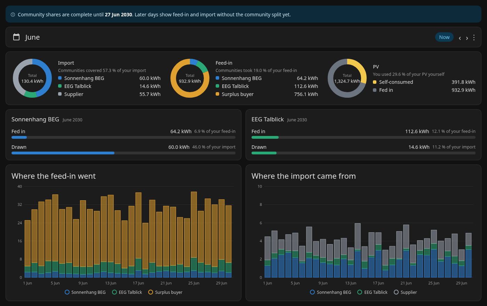

<p align="center">
  
</p>

<h1 align="center">EG Austria for Home Assistant (unofficial)</h1>

<p align="center">
  Hourly energy-community kWh from the EG Austria member portal as Home Assistant statistics. Read-only.
</p>

<p align="center">
  <a href="https://github.com/magicdude4eva/ha-eg-austria/releases"></a>
  <a href="LICENSE"></a>
  <a href="hacs.json"></a>
</p>

<p align="center">
  <b>English</b> · <a href="README.de.md">Deutsch</a>
</p>

**[EG Austria](https://eg-austria.at/) organises energy communities in Austria
(citizen energy communities, BEG, and renewable energy communities, EEG) and
gives every member a web portal with the metered hourly values of their
metering points. This integration reads those values and imports them into
Home Assistant long-term statistics: consumption, generation and how much of
it was shared with your communities, per hour. It is read-only, community-built
and unofficial.**

> **Not affiliated with, endorsed by or supported by EG Austria.** It uses the
> portal's undocumented web API, which may change or break at any time. It only
> reads your energy data; it never changes anything in your portal account. The
> one exception, creating or revoking the integration's own read-only access
> token, happens only in the setup wizard and only after you agree to it.

> [!TIP]
> **Joining EG Austria?** If this integration is useful to you, you can sign up
> with my referral link: <https://eg-austria.at/?ref=L79Y5W9G> (code
> `L79Y5W9G`). It supports the maintainer and costs you nothing extra. This is a
> personal referral, not a sponsorship by EG Austria.
>
> 🇦🇹 *Neu bei EG Austria? Mit dem Empfehlungscode `L79Y5W9G` unterstützt du
> dieses Projekt.*

## Contents

- [Highlights](#highlights)
- [Known limitations](#known-limitations)
- [Prerequisites](#prerequisites)
- [Installation](#installation)
- [Setup](#setup)
- [Token](#token)
- [Getting your data flowing](#getting-your-data-flowing)
- [What you get](#what-you-get)
- [Options](#options)
- [Energy community dashboard](#energy-community-dashboard)
- [Actions](#actions)
- [Examples](#examples)
- [Data updates](#data-updates)
- [Repairs and diagnostics](#repairs-and-diagnostics)
- [Troubleshooting](#troubleshooting)
- [Removal](#removal)
- [Supported devices](#supported-devices)
- [Privacy](#privacy)
- [Development](#development)

## Highlights

- **Hourly statistics per site and per energy community:** consumption,
  generation, from and to the community, and the residual from your supplier
  or to your surplus buyer.
- **Corrections overwritten:** each run fetches the recent weeks again, and a
  monthly run the last 13 months, so late grid operator corrections land in the
  right hour.
- **Unknown is never zero:** an hour the portal hasn't completed yet stays
  empty instead of being written as 0 kWh.
- **Checks before writing:** a changed portal format writes nothing; implausible
  values (for example negative or ten-fold) are held back while everything
  else is written.
- **Repairs** for an expiring token, a changed portal, held data and an
  unreachable portal; announced portal maintenance only postpones the run.
- **Redacted diagnostics:** tokens, ids, names and values are removed.
- **A token once a year:** the setup wizard can turn your monthly session
  cookie into a read-only access token that lasts a year.

## Known limitations

Structural, no setting changes them:

- **Undocumented API.** The portal has no public API. EG Austria staff are fine
  with the integration but don't promise a stable API, so a portal update can
  break it until the integration is updated. Nothing wrong is written in the
  meantime (see [Portal changed](#portal-changed)).
- **The data is late.** Metered values for a day appear one to several days
  later, the community shares up to weeks later. That comes from the grid
  operators, not from the integration. It is not live data.
- **Statistics, not sensors.** The values are external statistics. You can use
  them in the Energy dashboard and statistics cards, but they are not entity
  states, so you can't use them in automations or history graphs.
- **Nothing before your activation date.** The portal has no community data
  for days before your metering points joined a community, so neither does
  Home Assistant.
- **Tokens expire.** A session cookie lasts about a month, an access token a
  year. You get a repair warning before; then you paste a new session cookie.

Not done yet (phases, see [ADR 0010](docs/adr/0010-phasing.md)):

- **kWh only.** Money (tariffs, compensation) is planned for phase 2.
- **One site per entry, sums per site.** Per-metering-point statistics,
  several sites, Zero to other locations and new community models are planned
  for phase 3, with testers from the community. Add one entry per location in
  the meantime.
- Tested against one setup first (one site with generation and consumption,
  one BEG, one regional EEG). Other setups are supported as far as people with
  those setups help: please [open an issue](https://github.com/magicdude4eva/ha-eg-austria/issues).

## Prerequisites

- A Home Assistant version at least the one in the badge above (it is read
  from [`hacs.json`](hacs.json), which the Marketplace enforces).
- An EG Austria member account with at least one metering point in an
  energy community.
- A desktop browser to copy the session cookie once (see [Token](#token)).

## Installation

**Status:** released (0.1.0). The listing in the Home Assistant Marketplace
(formerly HACS) is pending
([#38](https://github.com/magicdude4eva/ha-eg-austria/issues/38)); until it
is live, install it as a custom repository by link:

1. Open the **Marketplace** in Home Assistant.
2. Open the three-dot menu → **Custom repositories**, enter
   `https://github.com/magicdude4eva/ha-eg-austria` with the type
   **Integration**, and select **Add**.
3. Search for **EG Austria**, open it and select **Download**.
4. Restart Home Assistant.
5. Go to **Settings → Devices & services → Add integration → EG Austria**.

> [!NOTE]
> **Once the listing is live**, skip step 2: search for **EG Austria** in the
> Marketplace directly. A custom repository you added before keeps working.

See the [changelog](CHANGELOG.md) for what changed in each release.

After you add the integration, Home Assistant opens a **Name and assign**
dialog for the "EG Austria" service device. An area makes no sense for this
service: just choose **Skip and finish**. Home Assistant offers this dialog for
every device a new entry creates, so the integration can't turn it off.

## Setup

The setup wizard asks for a session cookie from the portal first, then
offers two paths:

| Path | What is stored | Lasts | Pick it when |
|---|---|---|---|
| **Create the access token (recommended)** | A read-only access token named "Home Assistant" | One year | Almost always. You paste a cookie once a year instead of every month. |
| **Keep the session cookie** | The session cookie itself | About a month | You don't want an extra token on your account, or creating it failed. |

If you already have a personal access token (`ecapi_…`), you can paste it
instead of the cookie; then the wizard asks for its expiry date and skips the
choice.

The steps in order (steps with a single choice are skipped):

1. **Connect EG Austria**, field *Session cookie or token*: paste the session
   cookie (see [The session cookie: where to find it](#the-session-cookie-where-to-find-it)).
   Surrounding quotes and `portal.jwtToken=` are removed automatically.
2. **Personal token expiry**, field *Token valid until* (only for a pasted
   `ecapi_…` token): the expiry date you chose when you created it. Default:
   one year from today. You get a repair warning 30 days before.
3. **Member**, field *Member* (only if your login can act for several members):
   the member whose energy data is imported.
4. **Portal terms** (only if the portal says you haven't accepted the terms of
   use yet): log in to the portal in a browser and accept them, or the data
   requests may fail.
5. **Location**, field *Location* (only if the member has several locations):
   the site whose metering points this entry imports. Add another entry for
   another location.
6. **Create an access token?**: *Create the access token (recommended)* or
   *Keep the session cookie* (see the table above). If creating fails, the
   step **Access token not created** says why, and setup continues with the
   cookie.
7. **Session token expires soon** (only with the cookie kept and less than 7
   days left): a notice; setup continues.
8. **Metering points**, fields *Metering points* and *Site slug* (see
   [Member, location and metering points](#member-location-and-metering-points)
   and [Site and community slugs](#site-and-community-slugs)).
9. **Energy communities**, fields *Import* (the communities to import, all by
   default) and *Change the slugs* (off by default).
10. **Community slugs**, fields *Slug 1* … *Slug 9* (only with *Change the
    slugs* on): one slug per selected community.

The entry is called "EG Austria Home"; you can rename it. The first import
starts in the background a few minutes later (see
[Getting your data flowing](#getting-your-data-flowing)).

### The session cookie: where to find it

1. Log in to the member portal <https://portal.eg-austria.at> in a desktop
   browser (the portal sends you a login link by email).
2. Open the developer tools (F12) → **Application** (Firefox: **Storage**) →
   **Cookies** → `portal.eg-austria.at`.
3. Copy the value of `portal.jwtToken` and paste it into the wizard.

The cookie gives full access to your portal account while it is valid.
**Never share it**, not in an issue, a forum post or a screenshot. When you
let the wizard create an access token, the cookie is used for that one request
and then dropped; it is not stored.

### Token expiry: what happens when it runs out

You get the repair [Token expiry](#token-expiry) 30 days before an access
token expires, or 7 days before a session cookie expires. Paste a fresh
session cookie with **Reconfigure** and let the wizard create a new token.

If the portal rejects the token earlier (expired, revoked, or a portal
change), Home Assistant shows **Reconnect EG Austria** (re-authenticate) on
the integration. Paste a fresh session cookie, or an `ecapi_…` token of the
same member. A token of a different member is refused (`wrong_account`).

### Member, location and metering points

The member, location and metering point lists show what the portal returns:
member display names, the street and house number of each location, and for
each metering point its direction (consumption or generation), the **full**
metering point number, the facility name and source of production, and its
share per community. These appear only in the wizard, on your own Home
Assistant. They are not stored in the entry (only internal ids are), and logs,
diagnostics and the entry title never contain them.

All active metering points are selected by default. At least one is required.

### Site and community slugs

The slugs become part of the statistic ids, for example
`eg_austria:home_consumption` for the site slug `home` and
`eg_austria:home_beg_consumption_from_community` for the community slug `beg`.
**They can't be changed later**: a different slug would start new, empty
statistics.

- **Site slug:** default `home`. 1-20 lower case letters, digits or `_`,
  starting with a letter. A second entry needs a different one (`slug_in_use`).
- **Community slugs:** default from the community type: `beg` for a citizen
  energy community, `eeg` for a renewable energy community, then `eeg2`, …;
  `ec` for other types. Each option in *Import* shows the community name, its
  type, your member-since date and the proposed slug after the arrow. Same
  pattern as the site slug, unique within the entry (`duplicate_slug`).

The display names don't depend on the slugs: site statistics are shown as
"Home …", community statistics with the community name from the portal, which
is updated when the portal renames it.

### Reconfigure

**Settings → Devices & services → EG Austria → ⋮ → Reconfigure**. If the entry
holds an access token the wizard created, you choose between:

- **Change token, metering points or communities**: optionally paste a new
  session cookie or token (empty keeps the stored one), then change the
  metering points and add communities. Communities the portal no longer
  returns are listed; to keep the history of a community whose portal id
  changed, give the new community its old slug. Old slugs not reused are
  retired. If the stored location is no longer returned, the step **Location
  changed** asks which location the site now belongs to; statistic ids stay
  the same.
- **Revoke the access token**: paste a fresh session cookie (an access token
  can't revoke itself, `session_cookie_required`). The token is revoked; then
  you create a new one or keep the cookie.

A replaced token stays valid until it expires, so revoke it first if you no
longer need it.

## Token

Summary of the [setup](#setup) paths and the token's lifecycle:

- **Session cookie** (`portal.jwtToken`): copied from the browser, valid about
  a month. Pasted at setup, reauthentication, reconfigure and revoke.
- **Access token** (`ecapi_…`): created by the wizard from the cookie,
  **read-only**, named "Home Assistant", valid one year. EG Austria sends you
  an email about it ("Neuer Access-Token erstellt"). That email is expected.
- The integration stores only the token it uses, its expiry and (for a token
  it created) the token's id, in the Home Assistant config entry. It never
  logs the token or shows it back.
- **Revoke:** Reconfigure → **Revoke the access token** (see
  [Reconfigure](#reconfigure)). The portal has no page of its own to list or
  revoke tokens yet. If a token creation timed out, the token may exist anyway
  (you get the email); the wizard doesn't know its id, so it can't revoke it.

## Getting your data flowing

1. **Your community membership must be active.** The portal has community data
   only from the day your metering points joined a community.
2. **Finish the setup wizard.** No data is imported while you click through it.
3. **Wait a few minutes.** The first import starts in the background 1-5
   minutes after setup. With **Import history** on (the default), it fetches
   everything from your first activation date, month by month, with a pause
   between requests; a year of history takes a few minutes.
4. **Expect the latest days to be empty.** Yesterday and the days before are
   often missing or incomplete in the portal itself. They fill in on the next
   daily runs. Community shares can take weeks. **This is normal, not an
   error.**
5. **Check the diagnostic sensors** on the "EG Austria" device: *Last run
   status* should be *OK*, *Last import* shows when, and *Data complete until*
   the last day for which the portal had complete data.
6. **Find the statistics** in **Developer tools → Statistics** (search for
   `eg_austria`), then add them to the Energy dashboard or a statistics card.

## What you get

### Statistics

External statistics, unit kWh, hourly, with a running sum. `<site>` and `<c>`
are your [slugs](#site-and-community-slugs).

| Statistic id | Name | Meaning |
|---|---|---|
| `eg_austria:<site>_consumption` | Home Consumption | Metered consumption of the selected consumption points |
| `eg_austria:<site>_generation` | Home Generation | Metered feed-in of the selected generation points |
| `eg_austria:<site>_consumption_from_community` | Home Consumption from communities | Consumption covered by all your communities together |
| `eg_austria:<site>_generation_to_community` | Home Generation to communities | Feed-in taken by all your communities together |
| `eg_austria:<site>_consumption_from_supplier` | Home Consumption from supplier | The rest, from your electricity supplier |
| `eg_austria:<site>_generation_to_surplus` | Home Generation to surplus buyer | The rest, to your surplus buyer |
| `eg_austria:<site>_<c>_consumption_from_community` | *community name* Consumption from community | Consumption covered by community `<c>` |
| `eg_austria:<site>_<c>_generation_to_community` | *community name* Generation to community | Feed-in taken by community `<c>` |

Statistics of a direction without a selected metering point (for example
generation, if you only selected a consumption point) are not created. A
community's own statistics start at its activation date. The names follow the
Home Assistant language.

### Diagnostic sensors

On the "EG Austria" service device:

| Sensor | Shows |
|---|---|
| Token expires | When the stored token expires |
| Data complete until | Last day of the unbroken run of days the portal reports as complete (community shares) |
| Meter data until | Last day with meter values for every hour; usually about two weeks ahead of *Data complete until* |
| Last import | End of the last successful run |
| Last run status | *OK*, *Partly imported*, *Skipped (maintenance)*, *Authentication failed*, *Portal changed*, *Portal unavailable*, *Rate limited*; kept across restarts |
| Portal version | The portal build (disabled by default) |

They stay available while the portal is down: *Last run status* shows
*Portal unavailable* then. There are no energy sensors; the energy values are
statistics only.

### Summary sensors

Shares in percent that statistics cards can't calculate. Each comes twice:
*month so far* (from the 1st of this month up to *Data complete until*) and
*last month* (the latest month whose days are all complete). Numerator and
denominator always cover the same complete hours, so the late community data
and your live sources line up.

| Sensor | Share |
|---|---|
| Feed-in to communities | Generation to communities ÷ metered feed-in |
| Import from communities | Consumption from communities ÷ metered consumption |
| *community* feed-in share | That community's part of the metered feed-in |
| *community* import share | That community's part of the metered consumption |
| PV self-consumed | (PV production − metered feed-in) ÷ PV production, 0-100 % (only with a [PV source](#comparison-sources)) |
| PV to communities | Generation to communities ÷ PV production (only with a PV source) |
| PV to surplus buyer | Generation to surplus buyer ÷ PV production (only with a PV source) |
| Feed-in deviation | (your feed-in source − metered feed-in) ÷ metered feed-in (only with a feed-in source) |
| Grid consumption deviation | (your grid consumption source − metered consumption) ÷ metered consumption (only with a grid consumption source) |

Attributes: `period_start`, `period_end`, `numerator_kwh`,
`denominator_kwh`. A sensor is unknown when its period has no complete day yet
(early in the month, *month so far* often is) or the denominator is 0. They
have no state class, so Home Assistant keeps no long-term statistics of them;
the kWh values stay in the statistics above ([ADR 0014](docs/adr/0014-summary-sensors.md)).
The values are recomputed after Home Assistant starts and after every import.

> [!TIP]
> 💡 **Energy dashboard:** the integration never changes your Energy dashboard.
> If you already have a live local source (smart meter reader, inverter), keep
> it for grid consumption, return and solar: the portal data is days late, and
> adding both double counts. Use the `eg_austria` statistics in statistics
> cards to compare and to see your community shares.
>
> Without a local source, you can pick them in **Settings → Dashboards →
> Energy**: **Grid consumption** → `eg_austria:<site>_consumption`, **Return to
> grid** → `eg_austria:<site>_generation`. The last days then stay empty until
> the portal has them.

## Options

**Settings → Devices & services → EG Austria → Configure**, then pick
*Import settings* or *Comparison sources*. Each saves only its own fields. The
entry reloads when you save.

### Import settings

| Option | Default | Range | Effect |
|---|---|---|---|
| Plausibility limit per hour (kWh) | 50 | 1-1000, step 0.5 | Hourly values above this are held back as implausible. |
| Daily refetch window (days) | 62 | 31-400 | The last days fetched again on every daily run. |
| Monthly refetch window (months) | 13 | 1-36 | Months fetched again by the monthly run (late corrections). |
| Import history from the first activation | On | on/off | On the first run, import all data since the metering points joined a community. Off: only the daily window. |

### Comparison sources

Optional energy statistics from your own live meter or inverter, compared with
the portal data (summary values and the generated dashboard build on them). Any
brand works; each field takes an energy statistic with a total (state class
`total` or `total_increasing`, unit Wh, kWh, MWh, …).

| Option | Effect |
|---|---|
| Grid feed-in | Energy returned to the grid, as your live meter or inverter measures it. |
| Grid consumption | Energy drawn from the grid, as your live meter or inverter measures it. |
| PV production | Total energy your PV system produced. Without it, PV cards and values are left out. |

Until you save this step once, the fields are prefilled from the Energy
dashboard: the first grid source's *Return to grid* and *Grid consumption*,
and the first solar source. The integration only reads those settings and
never changes them. Leave a field empty if you don't have that source; the
integration's own `eg_austria:` statistics can't be picked here.

## Energy community dashboard

The integration brings a ready-made dashboard: core cards plus two small cards
of its own that follow the date picker. It uses your entry's statistics and
the [comparison sources](#comparison-sources) you picked, and leaves out cards
for sources you didn't set.

**Add it once:** **Settings → Dashboards → Add dashboard**, then under
*Custom* pick **EG Austria energy community**. The integration never creates
or changes dashboards by itself. The dashboard is rebuilt on every load, so a
new source or community shows up without editing it. To change it by hand,
use *Take control* in the dashboard menu; from then on it stays as you edited
it.

The dialog suggests the title *Energy community* and the icon
`mdi:home-group`; change them as you like.



*Example with made-up data.*

What it shows, one view per EG Austria entry, from top to bottom:

| Part | Cards |
|---|---|
| Picked period | A banner with the two delays (community shares complete until *Data complete until*, meter values until *Meter data until*); the **import status** in one row: *Data complete until*, *Meter data until*, *Last run* (green when OK, amber when a later run catches up: partial, maintenance, rate limited; red when it needs you: login failed, portal changed, unavailable), *Last import*, *Token expires* as a date (amber in the last two weeks, red once expired) and a link to the Energy dashboard; a click on a value opens its details. Then a date picker that opens on **this month**; use ‹ › to step to earlier months, or pick a week, a year or any range. Under it, following the picker: the **period card** with three donuts: *Import* (from each community and from the supplier, with the share covered by communities), *Feed-in* (to each community and to the surplus buyer, with the share the communities took) and, with a PV source, *PV* (self-consumed vs fed in); then **one card per community** with the kWh fed in and drawn and their share of all your feed-in and import; then where the feed-in went and where the import came from, by day |
| Last 12 months | The same two splits by month |
| Your own sources | With a PV source, PV production vs metered feed-in vs communities by month; with a feed-in or grid consumption source, metered vs your source for the picked period, as bars side by side (the two agree closely, so lines would cover each other) |

Charts sit in pairs on a wide screen and stack on a phone. Each community
keeps its colour in every chart (first blue, second green), the surplus buyer
is amber and the supplier grey. The labels follow your profile language
(English or German).

The date picker remembers the last preset you picked in your browser, like the
Energy dashboard. Until you pick one, the dashboard stores *This month* there
(only in the browser, never in Home Assistant), because *Today* has no
community data yet: community shares arrive about two weeks late. The newest
days show feed-in and import but no community split until the portal has it
(*Data complete until*).

The (i) in the top corner of the period and community cards explains how
their numbers are counted. Hover over a donut segment or its legend row (or
tap it on a phone) to see its share and kWh in the middle, the same part in the
previous period with the change in %, and its best day; a click or tap keeps
the selection until you click again. The period and community cards count only up to *Data complete until*, so
every number in them covers the same days; for the current month they say
*so far, until* that day. They read the picked period from the date
picker through a frontend detail that isn't a public API; if a Home Assistant
update changes it, they show the current month instead. The picker itself
shows the year only for months outside the current year (a Home Assistant
detail with no setting); the community cards always show it. In the built-in charts, Home Assistant
adds *(Change)* to every series name: the kWh in that bar (the change of the
meter total); there is no setting to hide it.

## Actions

### `eg_austria.refetch`: Re-fetch

Fetches a date range again from the member portal and rewrites its
statistics. Runs in the background.

| Field | Required | Description |
|---|---|---|
| `config_entry_id` (Entry) | yes | The EG Austria entry to run. |
| `start_date` (Start date) | no | First day to fetch. Default: the daily window (62 days) before the end date. |
| `end_date` (End date) | no | Last day to fetch. Default: today. At most 400 days after the start date. |

```yaml
action: eg_austria.refetch
data:
  config_entry_id: 0123456789abcdef0123456789abcdef
  start_date: "2026-01-01"
  end_date: "2026-03-31"
```

Refused when the start date is after the end date, the end date is in the
future, the range is longer than 400 days, the entry is unknown or not loaded,
or an import is already running for the entry.

### `eg_austria.release_held`: Release held days

Releases days that validation held back, so the next run writes them as the
portal sends them. It starts no run itself. Use it only after you checked in
the portal that the values are correct (see [Held data](#held-data)).

| Field | Required | Description |
|---|---|---|
| `config_entry_id` (Entry) | yes | The EG Austria entry. |
| `statistic_key` (Statistic key) | no | Only this statistic, for example `home_generation` (the statistic id without `eg_austria:`). Default: all. |
| `date` (Date) | no | Only this day. Default: all held days. |

```yaml
action: eg_austria.release_held
data:
  config_entry_id: 0123456789abcdef0123456789abcdef
  statistic_key: home_generation
  date: "2026-06-15"
```

Pick the entry in the action's UI editor, or copy its id from the address bar
of the entry's page.

## Examples

### Statistics card: how much came from the community

```yaml
type: statistics-graph
title: Community share
period: day
chart_type: bar
stat_types:
  - change
entities:
  - eg_austria:home_consumption
  - eg_austria:home_consumption_from_community
  - eg_austria:home_consumption_from_supplier
```

### Automation: notify when an import didn't go through

Replace the entity id with the one of your *Last run status* sensor
(**Settings → Devices & services → EG Austria → device**) and the notify
action with yours.

```yaml
alias: EG Austria import not OK
triggers:
  - trigger: state
    entity_id: sensor.eg_austria_home_last_run_status
    not_to:
      - ok
      - skipped_maintenance
      - unavailable
      - unknown
actions:
  - action: notify.notify
    data:
      title: EG Austria
      message: >-
        Last import: {{ states('sensor.eg_austria_home_last_run_status') }}.
        Check Settings → System → Repairs.
```

*Skipped (maintenance)* is left out because the run is retried after the
maintenance; a down portal has its own repair after three days.

### Automation: an extra weekly re-fetch

Every scheduled run already fetches the last 62 days and, monthly, the last 13
months, so this is rarely needed. If your grid operator corrects values often,
you can re-fetch the last 120 days every week (at most 400 days per call):

```yaml
alias: EG Austria weekly re-fetch
triggers:
  - trigger: time
    at: "07:30:00"
conditions:
  - condition: time
    weekday: sun
actions:
  - action: eg_austria.refetch
    data:
      config_entry_id: 0123456789abcdef0123456789abcdef
      start_date: "{{ (now() - timedelta(days=120)).date() }}"
```

## Data updates

The integration polls the portal (cloud polling); it can't be pushed to.

- **Daily run** at a fixed time between 03:00 and 06:00 local time, picked at
  random per entry at setup. It fetches from 62 days back (the *Daily refetch
  window*), or further back to the earliest incomplete day of the last 120
  days, up to today.
- **Monthly run:** the first daily run on or after the 3rd of each month
  fetches the last 13 months instead (*Monthly refetch window*), for late
  corrections.
- **Initial run:** after setup, everything from the first activation date (if
  *Import history* is on). It is repeated by the daily runs until it succeeds.
- **After a restart:** one catch-up run 1-5 minutes after Home Assistant has
  started, if the last successful run is older than 26 hours. None if a run was attempted in the last hour.
- **Maintenance:** before every run the portal's announced maintenance windows
  are checked. Inside one (± 30 minutes), the run is postponed to 30 minutes
  after its end (*Skipped (maintenance)*).
- **Load:** requests are sent one after the other, at least 2 seconds apart,
  about 4-10 per daily run and 15-30 on the monthly run. A rate-limited run
  makes the next one go slower.
- **Every run rewrites its whole window**, so corrected values replace the old
  ones. An hour that is unknown in a run keeps its stored value.
- **How late the data is:** metered values one to several days, community
  shares up to weeks. A day counts as complete once the portal flags it so.

## Repairs and diagnostics

The integration raises a repair in **Settings > System > Repairs** when it
needs you. Each one clears itself when the cause is gone.

### Token expiry

Raised 30 days before the expiry date of an access token (or the date you
entered for a personal token), or 7 days before a session token expires.
Create a new token and paste it with **Reconfigure** on the integration page
(see [Token](#token)). If the portal rejects the token earlier, Home Assistant
asks you to re-authenticate instead.

### Portal changed

The portal answered in a format the integration does not know, or said the
client is out of date. Nothing is written until a run passes the checks
again, so your statistics stay correct. Please download the diagnostics of the
entry or its device (three-dot menu > Download diagnostics; tokens, ids, names
and values are removed) and attach them to an
[issue](https://github.com/magicdude4eva/ha-eg-austria/issues).

### Held data

Some values failed a plausibility check (for example a negative or a
ten-fold value) and were not written; everything else was. The next run checks
those days again. If the portal shows the values as correct, the action
`eg_austria.release_held` lets the next run write them.

### Portal unreachable

No run succeeded on three calendar days in a row. Imports resume by
themselves; the portal keeps the data, so nothing is lost while it is down.

### Diagnostic sensors

Token expiry, data complete until, last import, last run status and (disabled
by default) the portal version. See [What you get](#diagnostic-sensors).

## Troubleshooting

### Setup errors

| Message | Cause and fix |
|---|---|
| This is neither a personal token (`ecapi_…`) nor a session token (JWT). | Copy only the value of `portal.jwtToken`, not another cookie. |
| The token has already expired. | Log in to the portal again and copy a fresh cookie. |
| Invalid date. | Enter a valid expiry date for the personal token. |
| The portal rejected the token. | The cookie or token is no longer valid; copy a fresh one. |
| This token belongs to a different member. | Reauthentication and revoke need a token of the entry's member. |
| The portal rejected the request. Accept the terms of use in the member portal first. | Log in to the portal in a browser and accept the terms of use. |
| No member is linked to this login. | The portal account has no member; check it in the portal. |
| The portal can't be reached right now. Try again later. | The portal is down, in maintenance or rate limiting. Try later. |
| The portal answered in an unexpected format. Please report an issue. | The portal changed; please [report it](https://github.com/magicdude4eva/ha-eg-austria/issues). |
| Unexpected error. | Enable [debug logging](#debug-logging) and report the issue. |
| Select at least one metering point. | Select one. |
| The selected metering points are in no energy community (or none is selected). | Select a metering point that is in a community, and at least one community. |
| Use 1-20 lower case letters, digits or `_`, starting with a letter. | Fix the slug, for example `home` or `beg`. |
| This site slug is already used by another entry. | Choose another site slug for the second entry. |
| This slug is already used in this entry. | Give every community its own slug. |
| The portal refused to create the access token. / could not be reached … / answered … in an unexpected way. | Setup continues with the session cookie; try again later with Reconfigure. If you still get the email, the token was created anyway. |
| Paste a session cookie (`portal.jwtToken`); an access token can't revoke tokens. | Revoking needs a fresh session cookie. |

Aborts: *This member and location are already configured* (the entry exists),
*The portal returned no location for this member*, *The location has no
metering points*, *More energy communities than this version supports* (more
than 9; please open an issue).

If setup of an existing entry is retried with "The EG Austria portal is
unreachable" or "… is in an announced maintenance window", Home Assistant
retries by itself. "The EG Austria portal rejected the token" or "The EG
Austria token has expired" leads to re-authentication.

### No data, or the latest days are empty

See [Getting your data flowing](#getting-your-data-flowing). Check the *Last
run status* and *Data complete until* sensors, and the repairs.

### Debug logging

On the integration page, choose **⋮ → Enable debug logging**, reproduce the
problem, then **Disable debug logging** to download the log. Or in
`configuration.yaml`:

```yaml
logger:
  default: warning
  logs:
    custom_components.eg_austria: debug
```

Tokens are never logged, and errors are redacted, but **read the log before
you post it** and remove anything personal (see [Privacy](#privacy)). For
most issues the diagnostics download is enough and safer.

## Removal

1. **Optional, first:** if the wizard created an access token, revoke it with
   **Reconfigure → Revoke the access token**. Otherwise it stays valid until it
   expires (one year), because deleting the entry doesn't revoke it.
2. Go to **Settings → Devices & services → EG Austria**, open the entry's
   **⋮** menu and choose **Delete**.
3. To uninstall the files, remove the integration in the Marketplace and
   restart Home Assistant.

What happens:

- **Deleted:** the config entry with the stored token, the entry's own store
  (run bookkeeping, held days), its repairs, the device and the diagnostic
  sensors.
- **Kept:** the imported statistics, so your history stays (ADR 0012). To
  delete them, go to **Developer tools → Statistics**, search for
  `eg_austria`, and remove each one. If you add the integration again with the
  same slugs, it continues the same statistics.
- **In the portal:** a token you didn't revoke stays until it expires. The
  portal has no page to revoke tokens yet.

## Supported devices

None: EG Austria is a web service. The integration creates one service device
per entry to hold the diagnostic sensors; it controls no hardware.

## Privacy

Your portal token is stored in the Home Assistant config entry only and is
never logged. When reporting issues, never post tokens, member or metering point
numbers, names, addresses or real values. See [PRIVACY](PRIVACY.md) for what
is read and stored, and [CONTRIBUTING](CONTRIBUTING.md).

## Development

See [CONTRIBUTING](CONTRIBUTING.md) for the setup, tests and the privacy
guard. Decisions are recorded in [`docs/adr`](docs/adr/README.md),
specifications in [`docs/spec`](docs/spec/README.md).

## License

[MIT](LICENSE)

## AI attribution

This project is written with the help of AI tools, and it is **not "AI slop"**:

- **Human-led:** a human maintainer sets the design, reviews every change and
  decides what gets merged. Architecture decisions and specifications are written
  down first ([`docs/adr`](docs/adr/README.md), [`docs/spec`](docs/spec/README.md));
  the code follows them in small, reviewed pull requests.
- **Tested:** every change runs through automated tests with synthetic data,
  linting, Home Assistant's `hassfest`, store validation and a privacy guard in CI.
  Each release also runs on the maintainer's own Home Assistant installation
  against a real portal account first.
- **Actively maintained:** it is built and used for the maintainer's own setup
  (one site with generation and consumption, a citizen energy community (BEG), a
  regional renewable energy community (EEG) and the Zero tariff option), so it is
  tested against that setup first. Other setups are supported as far as people
  with those setups help.
- **Community:** feedback, bug reports, fixes and enhancements from other users
  and contributors are welcome; see [CONTRIBUTING](CONTRIBUTING.md).

Commits and pull requests made with AI help end with:
"🤖 Generated / Supported with ❤️ Claudia, the better AI companion".
